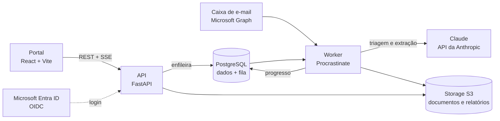

# RMA Pipeline (FastAPI)

[](https://github.com/FIlIpeDiBr/rma-pipeline-fastapi/actions/workflows/ci.yml)

Sistema web que recebe balancetes e DREs por upload ou por e-mail, extrai os dados com um LLM, calcula indicadores financeiros e gera o Relatório Mensal de Atividades (RMA) de cada empresa em `.docx`.

É a segunda versão do [rma-pipeline-apps-script](https://github.com/FIlIpeDiBr/rma-pipeline-apps-script). A primeira rodava em Google Apps Script com uma planilha como banco de dados; esta foi reescrita para sair desses limites. Foi construída para um escritório de contabilidade e está aqui sem dados de clientes.

*[English version](README.en.md)*

## Arquitetura



Uma única imagem Docker serve os dois papéis: a variável `SERVICE_ROLE` decide se o contêiner sobe a API ou o worker. A fila fica no próprio Postgres, então não há Redis nem outro serviço para operar.

| Camada | Tecnologia |
|---|---|
| API | Python 3.12, FastAPI, SQLAlchemy 2, Alembic |
| Fila | Procrastinate (jobs no PostgreSQL), tarefa periódica para a caixa de e-mail |
| IA | Claude: um modelo barato na triagem, um maior na extração e nos textos de análise |
| Relatórios | docxtpl (modelos `.docx` com Jinja) e matplotlib |
| Autenticação | Microsoft Entra ID (OIDC), sessão em cookie assinado |
| Frontend | React 18, TypeScript, Vite |
| Operação | Docker, Render (web + worker), Sentry, logs estruturados (structlog) |

## Do documento ao relatório

1. **Recepção.** O documento chega por upload ou pela caixa de e-mail. Os e-mails não entram direto: caem em uma fila de revisão, e uma pessoa escolhe quais anexos importar.
2. **Triagem.** Um modelo barato identifica empresa, período e tipo do documento.
3. **Conversão.** PDF com texto, planilha e CSV viram texto. PDF escaneado e imagem vão para o modelo como documento.
4. **Extração.** O modelo devolve JSON, que é reconciliado com um plano fixo de categorias sintéticas e gravado em uma transação.
5. **Cálculo.** Análise vertical e horizontal, e 23 indicadores definidos por fórmula. Empresas de um mesmo grupo são consolidadas.
6. **Relatório.** Um job monta o `.docx` a partir de um modelo, com tabelas, gráficos e parágrafos de análise escritos pelo modelo de linguagem.

O portal acompanha cada etapa em tempo real por SSE.

## Decisões de engenharia

**Jobs idempotentes e retomáveis.** Processar o mesmo documento duas vezes substitui os dados, não duplica. Documentos com a mesma chave de negócio (empresa, mês, ano e tipo) são deduplicados, e o mais recente vence. Uma falha marca o documento com erro e mensagem acionável, e o job é reexecutado.

**Custo de IA auditável.** Cada chamada ao modelo grava modelo, tokens, custo estimado, duração, prompt e resposta na tabela `ai_calls`. A triagem usa um modelo mais barato que a extração.

**Indicadores como dados.** As 23 definições ficam em tabela, e cada organização pode sobrepor uma fórmula sem mexer no código. As fórmulas passam por um avaliador próprio, sem `eval`, que só entende aritmética e os valores do período.

**Revisão humana na entrada por e-mail.** O sistema lê a caixa a cada 5 minutos, mas nenhum anexo entra no pipeline sem alguém aprovar. Um e-mail é um canal aberto; a fila de revisão impede que um remetente qualquer injete documentos.

**Isolamento por organização.** Toda tabela carrega `org_id` e toda consulta filtra por ele. Um teste percorre as rotas e falha se alguma rota de `/api` não exigir autenticação.

**Modelos de relatório em ambiente restrito.** Um modelo `.docx` é código Jinja. Os modelos enviados pelo portal são renderizados em um ambiente que bloqueia o acesso aos internos do Python e escapa os valores, de modo que quem sobe um modelo não executa código no worker.

**Falhar cedo na configuração.** Em produção, a aplicação não sobe com a chave de sessão padrão. A conexão com o banco tem tempo limite, para o health check responder mesmo quando o banco não responde.

## Rodando localmente

Pré-requisitos: Python 3.12+, Node 22+ e Docker.

```bash
# 1. Banco
docker compose up -d

# 2. Backend
cd backend
python -m venv .venv && source .venv/bin/activate   # no Windows: .venv\Scripts\activate
pip install -e ".[dev]"
cp ../.env.example ../.env                          # preencha o necessário
alembic upgrade head
procrastinate --app=app.jobs.job_app schema --apply
uvicorn app.main:app --reload                       # http://localhost:8000

# 3. Worker (outro terminal, mesma venv)
procrastinate --app=app.jobs.job_app worker

# 4. Frontend (outro terminal)
cd frontend
npm ci
npm run dev                                         # http://localhost:5173
```

As variáveis estão em [`.env.example`](.env.example). Sem `ANTHROPIC_API_KEY` e `STORAGE_*` a API sobe, mas o pipeline não processa documentos.

## Testes

```bash
cd backend
ruff check .
pytest
```

Os 49 testes rodam sem banco, sem rede e sem chave de API: usam SQLite em memória e dublês para storage, e-mail e IA. Cobrem a normalização de categorias, o reparo de JSON, a persistência e a deduplicação, o motor de indicadores, a consolidação de grupos, a montagem do relatório e as regras de segurança.

O CI roda lint, testes, o build do frontend e o build da imagem Docker.

## Deploy

O [`render.yaml`](render.yaml) descreve os dois serviços (web e worker) a partir da mesma imagem. As migrações rodam na subida do serviço web.

## Limitações conhecidas

- O frontend não tem testes nem lint, e os componentes maiores concentram estado e chamadas de API.
- O progresso em tempo real consulta o banco a cada 1,5 s por conexão. `LISTEN/NOTIFY` do Postgres evitaria a consulta periódica.
- O upload lê o arquivo inteiro na memória antes de checar o limite de tamanho.
- Na prática há uma organização só: ela é criada pelo nome configurado no primeiro login.
- Os testes de API cobrem autenticação e saúde. Os fluxos completos, com banco real, não têm teste automatizado.
- O custo de IA é estimado com uma tabela de preços fixa no código.

## Autor

Filipe Dias Brandão · [github.com/FIlIpeDiBr](https://github.com/FIlIpeDiBr)

Código publicado para fins de portfólio. Todos os direitos reservados.
